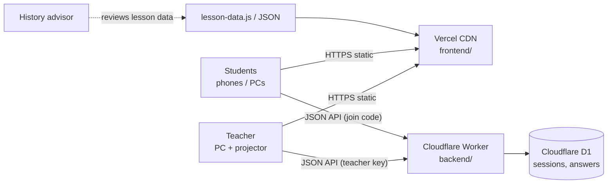
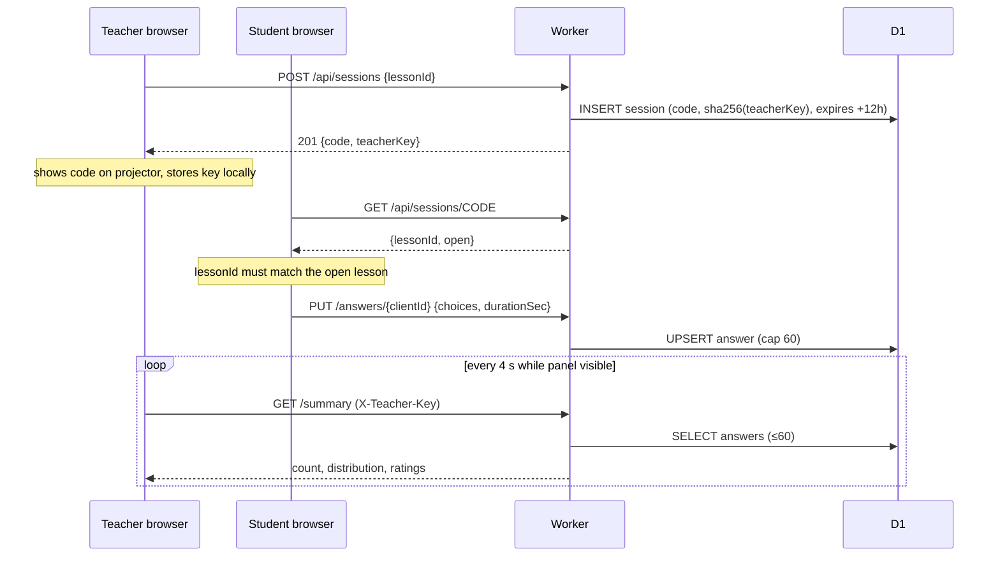
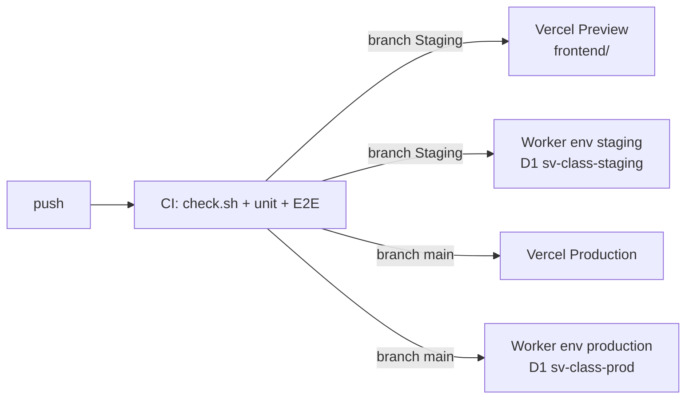

# System design: Sử Việt classroom simulation demo

| | |
|---|---|
| Status | v1.0, 2026-11-03 |
| Scope | Demo of one lesson (Ngọc Hồi - Hạ Hồi) per PRD; F1-F8 (P0), F10 and F11 (P1). F9 deferred |
| Inputs | PRD (`docs/prd/`), spec [`specs/001-classroom-sim-demo/spec.md`](../../specs/001-classroom-sim-demo/spec.md), constitution (`.specify/memory/constitution.md`) |
| Requirements doc | [SRS](../srs/SRS.md) |

## 1. Drivers

| Driver | Consequence for the design |
|---|---|
| Weak school PCs, projectors, phones; unreliable school internet | Lesson runs fully in the browser (offline-first); light 2.5D scene with a low-quality mode; no framework or build |
| Minors' data (PRD NFR privacy) | No accounts; anonymous random ids; nothing identifying stored; 180-day retention |
| Content correctness and explainability | Content labelled as unreviewed; deterministic engine driven by lesson data; assumptions shown |
| One lesson, 12-week demo, 4-5 people | Smallest system that meets F10/F11: one Worker, one SQL database, polling |
| Deploy on Vercel + Cloudflare, frontend and backend in separate folders | `frontend/` → Vercel static; `backend/` → Cloudflare Workers + D1 |

## 2. Context



The browser holds all lesson content and does every calculation. The Worker only stores who chose
what, anonymously, for a class session.

## 3. Components

### 3.1 Frontend (`frontend/`, static)

| Module (`window` global) | Responsibility |
|---|---|
| `text.js` | NFC normalisation of all text writes (loaded first) |
| `config.js` → `APP_CONFIG` | `apiBase` per environment (localhost → `:8787`; deployed → Worker URL; empty → class features off) |
| `auth.js` → `Auth` | Demo login (client-side only, not security) |
| `lesson-data.js` → `SEED_LESSONS` | Lesson schema + seed content |
| `storage.js` → `LessonStorage` | Lessons in localStorage, student visibility rule, import/export |
| `engine.js` → `SimulationEngine` | Deterministic `calculate` + `generateExplanation` |
| `scene-map.js` → `BattleScene3D` | three.js silk-map scene; one instance per surface; `destroy()` on teardown |
| `audio.js` → `BattleAudio` | Procedural battle sound |
| `class-session.js` → `ClassSession` | NEW: API client, teacher/student session state in localStorage, timeouts, Vietnamese error mapping |
| `app.js` | Controller: router, views, editor, 6-stage loop; renders the class panel (stage 3) and survey (stage 6) |

CSS cascade: `theme.css` (tokens) → `fonts.css` → `style.css` → `editorial.css` → `redesign.css`
(Trung's Sử Việt identity) → `classroom.css` (class panel, survey, stage polish).

### 3.2 Backend (`backend/`, Cloudflare Worker)

```
src/index.js     fetch(): CORS → body limit → route → handler → JSON/CSV; scheduled(): purge
src/handlers.js  pure functions (req data, store, now) → {status, body}; validation; CSV
src/store.js     D1Store (SQL) | MemoryStore (tests, dev-server) — same methods
```

Store interface: `createSession`, `getSession`, `countAnswers`, `getAnswer`, `upsertAnswer`,
`listAnswers`, `deleteSession`, `purgeBefore`.

### 3.3 API (summary; full contract in [contracts/api.md](../../specs/001-classroom-sim-demo/contracts/api.md))

| Method | Path | Who |
|---|---|---|
| GET | `/api/health` | anyone |
| POST | `/api/sessions` | teacher device (gets `teacherKey`) |
| GET | `/api/sessions/:code` | anyone with the code (no answers) |
| PUT | `/api/sessions/:code/answers/:clientId` | student device |
| GET | `/api/sessions/:code/summary` | `X-Teacher-Key` |
| GET | `/api/sessions/:code/export.csv` | `X-Teacher-Key` |
| DELETE | `/api/sessions/:code` | `X-Teacher-Key` |

## 4. Key flows

### 4.1 Class session (F10)



### 4.2 Trial data (F11)

Stage 6 survey → `PUT /answers/{clientId} {ratings, durationSec}` (merge). Teacher → `GET
export.csv` (anonymous ids A01…, formula-injection-safe) → `DELETE` when done; cron purges at 180 days.

### 4.3 Degraded modes

| Condition | Behaviour |
|---|---|
| `apiBase` empty | Class panel says the class server is not configured; lesson unaffected |
| Network error / timeout (6 s) | Panel shows "Chưa kết nối được máy chủ lớp học; bài học vẫn chạy bình thường trên máy này"; polling backs off to 15 s |
| Session expired / deleted | Student and teacher state cleared, message shown |
| WebGL missing | Scene area notice; text, question, comparison, explanation still work |

## 5. Data

See [data-model.md](../../specs/001-classroom-sim-demo/data-model.md). Two tables, `sessions(code PK)`
and `answers(session_code, client_id PK)`. No identity columns. Lesson content is not sent to the
server; only option ids.

## 6. Security and privacy

| Threat | Control |
|---|---|
| Reading another class's data | Reads need the teacher key; only its SHA-256 stored; constant-time compare |
| Guessing a code to spam answers | 31⁶ codes; 60-answer cap; 12-h window; strict validation; 4 KB body limit |
| Stored XSS via answers | Only `[A-Za-z0-9_-]` ids and integers accepted; the UI renders option names from local lesson data, not server strings |
| CSV formula injection | Prefix `'` on cells starting with `= + - @` |
| Cross-origin abuse | CORS allow-list (`ALLOWED_ORIGINS`) |
| Personal data | No names/IP/UA stored; Worker request logs off; new random id per session; retention 180 days |
| Demo login mistaken for security | Kept labelled "demo"; not used by the API |

## 7. Performance and capacity

- Frontend: no build; heaviest asset is `three.min.js` (~603 KB, cached). Brand logo reduced from 821 KB to a small PNG. Low-quality scene mode for weak GPUs.
- Backend per class (60 students, 45 min): ≈ 120 answer writes + ≈ 700 teacher polls.
- Scaling out:
  - Workers are stateless and run at the PoP nearest each user; there is no server to size.
  - D1 is one SQLite primary per database, so the design keeps per-request work small and bounded instead of adding caches or queues.
- Student submit (`PUT answers`) = 2 queries: read the session row, then one atomic upsert that also enforces the 60-device cap. No read-modify-write race.
- Teacher poll (`GET summary`, every 4 s, paused while the tab is hidden, 30 s back-off on errors):
  - Answers `304` from the session row alone when `sessions.version` is unchanged, which is most polls (1 row read, no body).
  - A changed summary reads ≤ 60 answer rows.
- Rough ceiling on the free plans (100k Worker requests/day, 5M D1 rows read/day, 100k rows written/day):
  - ≈ 100 class-periods per day, bounded by Worker requests.
  - Writes allow ≈ 400 (answer row + session version row per submit).
  - Paid plans raise every limit; no code change is needed.
- Next levers, only if usage shows the need:
  - D1 read replication (Sessions API) for the session read.
  - A Workers rate-limit binding on `POST /api/sessions`.
  - Longer poll interval via `APP_CONFIG.pollIntervalMs`.
- Latency: Cloudflare PoPs in Hanoi/HCMC; every query is a primary-key or index lookup.

## 8. Deployment



- Secrets (repo admin): `VERCEL_TOKEN`, `VERCEL_ORG_ID`, `VERCEL_PROJECT_ID`, `CLOUDFLARE_API_TOKEN`, `CLOUDFLARE_ACCOUNT_ID`. A deploy job without its secrets is skipped with a notice, not failed.
- Rollback: Vercel "promote previous deployment"; `wrangler rollback`. D1 migrations are additive.
- Runbook: [docs/devops/DEPLOY.md](../devops/DEPLOY.md).

## 9. Testing strategy

| Level | Tool | Covers |
|---|---|---|
| Static | `scripts/check.sh` | JS syntax, JSON, references, script load list |
| Unit (frontend logic) | `node:test` + `vm` | Engine determinism over 81×2 runs, grading-word scan, storage visibility rule |
| Unit (backend) | `node:test` + MemoryStore | Every endpoint, validation, cap, expiry, auth, CORS, CSV |
| E2E | Playwright (desktop + 360 px) | 6-stage loop, labels, class session with 3 browser contexts, CSV, offline mode, intake gate |

## 10. Decisions and trade-offs (ADR summary)

| # | Decision | Trade-off accepted |
|---|---|---|
| 1 | Keep plain JS, no framework/build | `app.js` stays large; new logic goes into separate modules |
| 2 | Workers + D1, not Vercel Functions + Postgres | Two vendors, but each does what it is best at and both are free at demo scale |
| 3 | Polling, not websockets | Up to 4 s delay; acceptable for SC-003 |
| 4 | Teacher key instead of accounts | Losing the teacher device's storage loses read access to that session (it still expires/purges) |
| 5 | Lessons stay in the browser | Teacher edits are per-device; a server content store waits for the approved data set (plan step 3) |
| 6 | F9 (LLM) deferred | Character stays scripted; re-evaluate at gate T7 with a RAG design over the approved set |

## 11. Evolution (not built now)

Server-side approved lesson store with advisor sign-off workflow; F9 RAG character with citations
and "tài liệu không ghi lại"; QR code join; teacher accounts via school SSO.

## 12. Atlas Việt Nam (v2, branch `Dat/feature/v2-atlas`)

Static data plus a framework-agnostic renderer; no backend involvement.

```
scripts/atlas/build-*.mjs ──(OSM, Natural Earth, Wikidata, AWS Terrain Tiles)──▶
  frontend/src/content/atlas/{provinces.topo.json, landmarks.json}   (bundled with the route chunk)
  frontend/public/atlas/terrain.png                                  (fetched at runtime)
routes/atlas.tsx ── validateSearch(decodeAtlasState) ──▶ features/atlas/AtlasView.tsx (React, Tailwind)
                                                          └─▶ features/atlas/scene.ts (three.js)
                                                          └─▶ features/atlas/search.ts (pure, unit-tested)
```

- **Scene** (`VietnamAtlasScene`): a CPU-displaced plane (256 or 128 segments; raycasts hit the real
  surface) with a shader that tints height, depth and hillshade from `terrain.png` using the palette
  from CSS variables. A runtime canvas mask marks Viet Nam's land and the selected unit. Province
  borders are line segments draped over the relief. Markers are one `InstancedMesh` per kind, each
  kind with its own shape, scaled with camera distance. Labels are HTML spans placed by greedy
  collision culling, avoiding boxes the view reserves for its buttons. It renders on demand only.
  `focusPlace` flies the camera with easing, or jumps under `prefers-reduced-motion`. `setViewInsets`
  uses a camera view offset so the target stays centred above a phone bottom sheet. `destroy()`
  disposes GPU objects and calls `forceContextLoss`.
- **Ids**: province, archipelago and landmark ids share one space (tested disjoint), so `onSelect`
  and `?place=` take any of them.
- **Lessons ↔ places**: both directions are honoured: `landmark.lessonIds` and `lesson.atlasPlaceIds`.
- **Budget**: atlas chunk 69.6 KB gzip + shared three.js 136 KB, loaded only on `#/atlas`;
  boundaries 37 KB gzip; terrain 1 MB. A failed WebGL context shows a Vietnamese message and the
  lists keep working.
- **ADR**: draped border lines over a texture-baked border or flat extruded units (measured, see
  `notes/s3.md`); a small built-in TopoJSON decoder instead of `topojson-client` at runtime; OSM borders
  clipped to land instead of a dissolve of the 63 old provinces (more accurate; the dissolve is the
  cross-check and the fallback via `ATLAS_BOUNDARIES=dissolve`).
